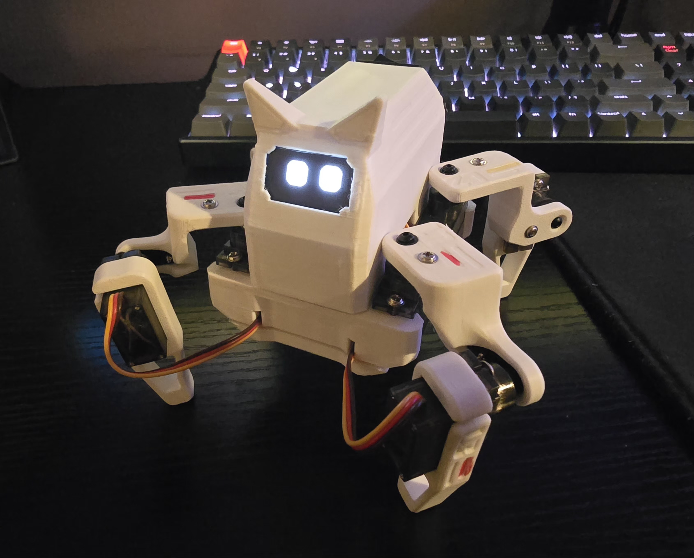
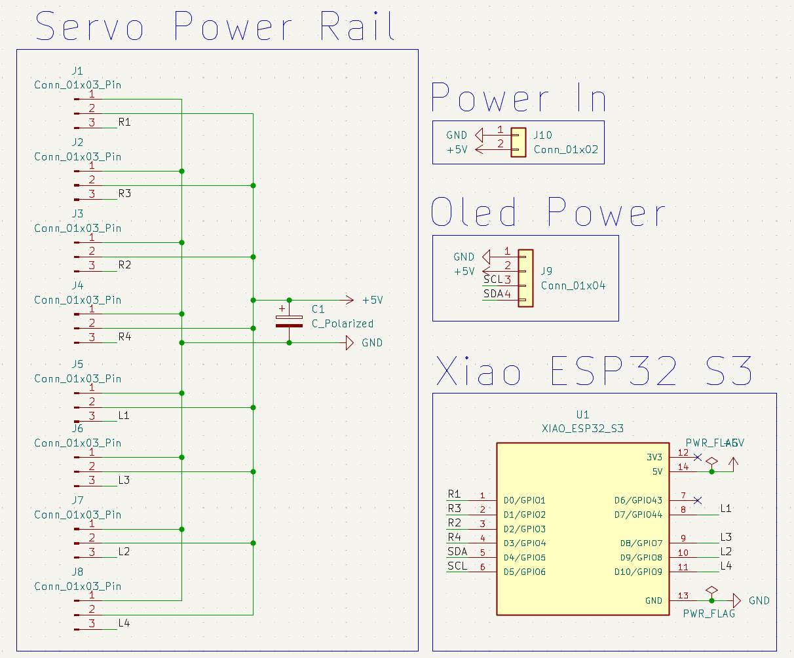
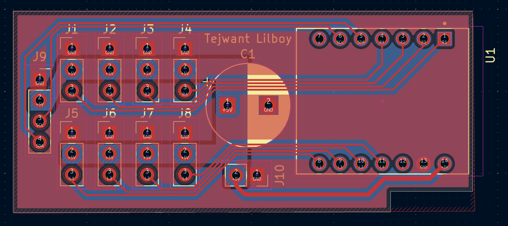
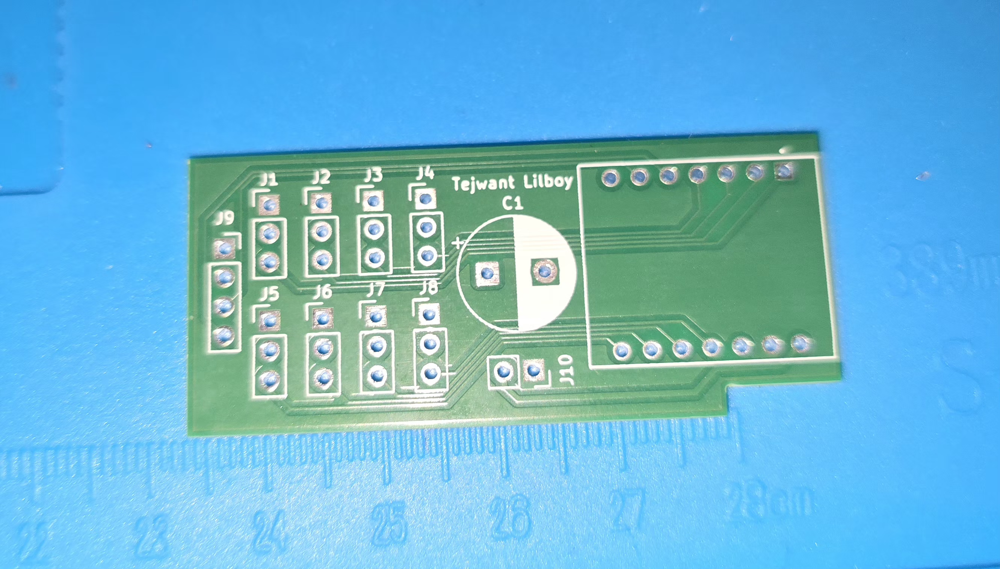
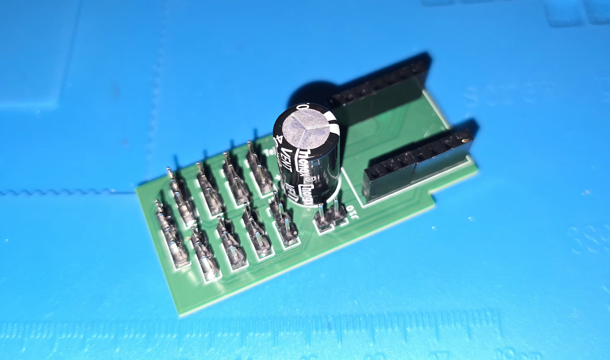
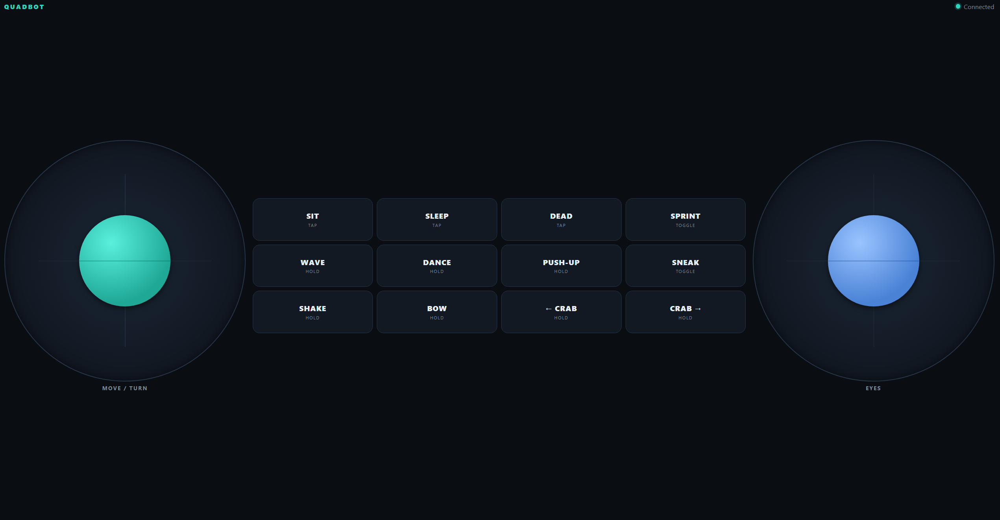

# QuadBot 🕷️



### ESP32-based wireless quadruped robot

QuadBot is a custom-built four-legged robot powered by an ESP32 and eight servo motors. It walks, turns, crab-walks and performs tricks, and an animated OLED face reacts to everything it does.

You can drive it two ways, from the same codebase:

| Version | Control | Link |
|---|---|---|
| **Xbox version** | Xbox wireless controller | Bluetooth (Bluepad32) |
| **Web version** | Any phone with a browser | The robot's own WiFi network, no router or app needed |

The project combines embedded programming, electronics and PCB design, servo control and mechanical robotics.

---

## Contents

- [Features](#features)
- [Hardware](#hardware)
- [Getting started](#getting-started)
- [Controls](#controls)
- [Web version](#web-version-phone-control-over-wifi)
- [How the firmware works](#how-the-firmware-works)
- [Repository layout](#repository-layout)
- [Roadmap and status](#roadmap-and-status)
- [Credits](#credits)

---

## Features

- **Eight-servo locomotion:** walk forward and backward, turn on the spot, and crab walk sideways.
- **Two ways to drive:** an Xbox controller over Bluetooth, or a phone with on-screen joysticks over WiFi.
- **Analog speed:** the further you push the stick, the faster the gait. Sprint and sneak modes change speed and stride.
- **Smooth motion:** servos glide to their targets at a limited speed instead of snapping.
- **Walk drift correction:** a tunable stride offset compensates for mechanical differences between the two sides.
- **Tricks:** wave, dance, push-ups, shake, bow, sit, sleep and play dead.
- **Animated OLED face:** a different face for every action, blink transitions, and 24 random idle animations. The right stick moves the eyes.
- **Idle behavior:** after 60 seconds without input the robot yawns and goes to sleep. Any input wakes it.
- **Custom power distribution PCB** designed for eight servos in a small body.

---

## Hardware

| Component | Description |
|---|---|
| Microcontroller | Seeed XIAO ESP32-S3 |
| Servos | 8x MG90S |
| Display | SSD1306 128x64 OLED (I2C) |
| Control | Xbox wireless controller (Bluetooth) or phone (WiFi) |
| Power | 7.4 V 800 mAh 2S Li-ion battery |
| Regulation | 5 V buck converter (battery to servo and logic supply) |
| Distribution | Custom-designed power distribution PCB |

### Power distribution PCB

Running eight servos in a small body puts real demands on current and space, so the robot uses a custom PCB that distributes power to the microcontroller and servos from one place.

| Schematic | PCB layout |
|---|---|
|  |  |

| Unsoldered | Soldered |
|---|---|
|  |  |

### Servo map

Each leg has a **hip** servo (swings the leg back and forth) and a **lift** servo (raises and lowers the foot). Every servo has its own LEDC PWM channel.

| Servo | Leg | Function | Pin | Home | Extended |
|---|---|---|---|---:|---:|
| R1 | Front right | Hip | D0 | 0° | 90° |
| R2 | Rear right | Hip | D2 | 90° | 0° |
| L1 | Front left | Hip | D7 | 90° | 0° |
| L2 | Rear left | Hip | D9 | 0° | 90° |
| R3 | Front right | Lift | D1 | 180° | 0° |
| R4 | Rear right | Lift | D3 | 0° | 180° |
| L3 | Front left | Lift | D8 | 0° | 180° |
| L4 | Rear left | Lift | D10 | 180° | 0° |

For a lift servo, "home" means the foot is on the ground. These values match the current mechanical build, so re-measure them if you build your own.

### OLED connections

| OLED pin | ESP32 pin |
|---|---|
| SDA | D4 |
| SCL | D5 |
| I2C address | 0x3C |

---

## Getting started

Both versions use the Arduino IDE. Each sketch must sit in a folder with the same name as the `.ino` file.

| | Xbox version | Web version |
|---|---|---|
| **Sketch** | `robot_xbox/robot_xbox.ino` | `web_version_quadbot/web_version_quadbot.ino` |
| **Board package** | ESP32 / [Bluepad32](https://github.com/ricardoquesada/bluepad32) board package | **esp32** by Espressif Systems (board: `XIAO_ESP32S3`) |
| **Libraries** | Adafruit GFX, Adafruit SSD1306 | Adafruit GFX, Adafruit SSD1306, **WebSockets** by Markus Sattler |

Install libraries from the Library Manager (Sketch → Include Library → Manage Libraries). The Bluepad32 library comes with its board package. `WiFi.h` and `WebServer.h` are built into the esp32 package.

The first compile after installing a new board package can take several minutes. Later compiles are much faster.

**Xbox version:** upload the sketch, then put the controller in pairing mode. The face switches from "searching" to "hello" when it connects.

**Web version:** upload the sketch, then follow [the quick start below](#quick-start).

---

## Controls

Both versions share the same actions.

| Action | Xbox controller | Web page |
|---|---|---|
| Walk forward / backward | Left stick up / down | Left joystick up / down |
| Turn left / right | Left stick left / right | Left joystick left / right |
| Move the eyes | Right stick | Right joystick |
| Sprint | RT (hold) | SPRINT (toggle) |
| Sneak | LT (hold) | SNEAK (toggle) |
| Crab walk left / right | LB / RB (hold) | ← CRAB / CRAB → (hold) |
| Sit / stand | A | SIT (tap) |
| Play dead | X | DEAD (tap) |
| Sleep / wake | D-pad down | SLEEP (tap) |
| Dance | B (hold) | DANCE (hold) |
| Wave | Y (hold) | WAVE (hold) |
| Push-ups | D-pad up (hold) | PUSH-UP (hold) |
| Shake | D-pad left (hold) | SHAKE (hold) |
| Bow | D-pad right (hold) | BOW (hold) |

Walking speed follows how far the stick is pushed. After 60 seconds with no input the robot yawns (at 56 s), lies down and sleeps. Any input wakes it. Manual sleep only wakes with the sleep control.

---

## Web version: phone control over WiFi

The web version replaces the Bluetooth controller with a phone. The ESP32 creates its own WiFi network and serves a control page with two on-screen joysticks and buttons. No router, internet connection or app is needed, and the page works in portrait or landscape.


### Quick start

1. Upload `web_version_quadbot.ino`.
2. On your phone, join the WiFi network **QuadBot** (password **quadbot123**).
3. Open Chrome or Safari and go to **http://192.168.4.1** (type the `http://` yourself).
4. The robot's face changes from "searching" to "hello" when the page connects.

The phone will say the network has no internet, because the robot is not a router. Choose to stay connected.

### How it works

```
phone browser  --HTTP (port 80)-->   ESP32   serves the control page once
phone browser  --WebSocket (81)-->   ESP32   streams joystick and button state
```

- The ESP32 runs as a WiFi access point and serves one HTML page stored in flash.
- The page opens a WebSocket back to the robot, so it never reloads. It sends one line of text about 30 times a second whenever something changes, and at least every 150 ms as a heartbeat:

  ```
  s,lx,ly,rx,ry,buttons,dpad,lt,rt
  ```

  | Field | Meaning |
  |---|---|
  | `lx ly rx ry` | Stick positions, -512 to 512 (up and left are negative, like a gamepad) |
  | `buttons` | Bit mask: A=1, B=2, X=4, Y=8, L1=16, R1=32 |
  | `dpad` | Bit mask: UP=1, DOWN=2, RIGHT=4, LEFT=8 |
  | `lt rt` | Triggers, 0 to 1023 (the page sends 0 or 1023: SNEAK = `lt`, SPRINT = `rt`) |

- On the robot, a small `WebPad` object holds that state and exposes the same getters as a Bluepad32 controller. Because of this, the gait, faces, tricks and auto-sleep code is identical to the Xbox version. Only the input layer changed.
- Sprint and sneak are toggles, because holding a button while steering with both thumbs would need a third thumb. Only one can be on at a time. On Android the phone vibrates where the Xbox controller would rumble (iPhones ignore it).

### Safety

- **Deadman timer:** if the robot hears nothing for 0.5 s (phone locked, out of range, page closed), it treats every input as released and stands still.
- **Disconnect:** after 4 s of silence the phone counts as disconnected and the face shows the sad "connection lost" expression. The page reconnects by itself.
- **One driver at a time:** a second phone is refused while the first is actively driving. If the first has gone quiet, the second can take over.

### Settings

| Setting | Effect |
|---|---|
| `AP_SSID`, `AP_PASS` | WiFi name and password (the password needs at least 8 characters) |
| `DEADMAN_MS` (500) | How long a quiet phone is tolerated before inputs are released |
| `DROP_MS` (4000) | How long a quiet phone is tolerated before it counts as disconnected |
| `PAGE` | The HTML, CSS and JavaScript of the control page, at the end of the sketch. Edit it to change the layout, colors or labels |

<details>
<summary><b>Web version troubleshooting</b></summary>

- **The page will not load:** check that you joined the **QuadBot** network, and type `http://192.168.4.1` including `http://`. The Serial Monitor (115200 baud) prints the address at startup.
- **The page says "Connecting...":** only one phone can drive at a time. Close other tabs or phones that have the page open, and wait a few seconds if one was just closed.
- **The phone keeps leaving the network:** Android and iOS may switch back to mobile data because the network has no internet. Choose "stay connected", or turn off the automatic switch for that network.
- **The robot stops when the phone screen turns off:** this is the deadman timer working as designed. Set a longer screen timeout while driving.
- **SIT, SLEEP or DEAD do not respond while walking:** these toggles are only read between gait cycles. Tap them while the robot is standing.

</details>

---

## How the firmware works

Both sketches share the same structure. Only section 3 (the controller input) differs.

| Section | Description |
|---|---|
| 1. Servo driver | Custom LEDC PWM driver, no Servo library |
| 2. Settings | Speeds, frame times, drift correction |
| 3. Controller | Bluepad32 (Xbox version) or WiFi and WebSocket (web version) |
| 4. OLED face | Drawing helpers, idle animations, the face engine |
| 5. Timing helpers | Speed scaling and waits that keep the robot responsive |
| 6. Poses and movements | Pose tables and the functions that play them |
| 7. State | Sit, sleep and play-dead toggles, and auto-sleep |
| 8. `setup()` and `loop()` | Startup and the main loop |

**Servo driver.** Each servo gets its own ESP32 LEDC channel (50 Hz, 14-bit). Writing an angle only sets a target, and the driver moves toward it at a limited speed, which is what makes every motion smooth.

**Movement system.** A pose is eight servo angles, and a movement is a table of poses played one per gait frame. To change how the robot moves, edit the numbers in its table. Walking is a diagonal trot, backward is the same table played in reverse, and drift correction shortens one side's stride.

**Non-blocking by design.** Movement code never uses `delay()`. It waits with helpers that keep the servos gliding, the controller read and the face animating, so every movement stops the moment its input is released.

**OLED face engine.** Faces are drawn with code using the Adafruit GFX library, with no image files. When the requested face changes, the lids blink shut, the face swaps and the lids reopen. With no input, a state machine plays a calm face and then a random one of 24 idle animations.

---

## Repository layout

```
QuadBot/
├── Images/                                      photos and PCB images
├── robot_xbox/
│   └── robot_xbox.ino                           Xbox controller version (Bluetooth)
├── web_version_quadbot/
│   └── web_version_quadbot.ino                  phone version (WiFi and web page)
└── README.md
```

The two versions share the same servo calibration, gait and faces. If you change a pose table or add a face in one, copy the change to the other.

---

## Roadmap and status

**Status: functional prototype.** QuadBot supports wireless manual control from a controller or a phone, multiple movement sequences, interactive OLED animations and autonomous idle behavior.

Planned improvements:

- Better walking stability and gait optimization.
- Inverse kinematics for more precise foot positioning.
- Obstacle detection and environmental sensing.
- Autonomous movement.
- More movement sequences and an improved mechanical design.

---

## Credits

The original QuadBot concept and 3D-printable STL files were created by [**Dorian Todd and his Sesame Project**](https://github.com/dorianborian/sesame-robot). The electronics, component selection, custom power distribution PCB, firmware, software and overall hardware implementation are my own work.

---

*Designed, assembled, programmed and developed as a personal robotics project.*
